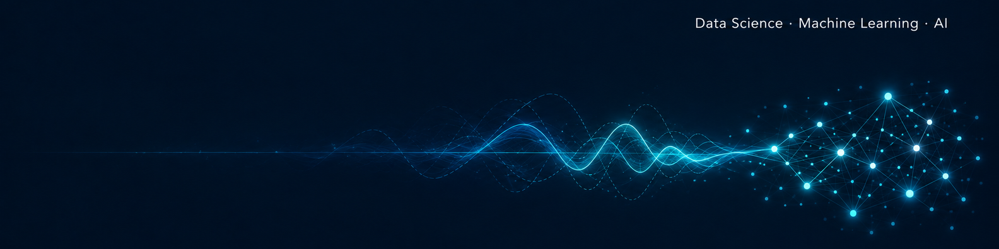

# Hi, I'm Rafael Guimaraens

**Data Science & Machine Learning student** at UniCEUB in Brasília, Brazil. I'm building a solid mathematical foundation to work with data and AI, and I have a long-standing passion for modern physics.

This is where I document what I build as I learn, from data analysis and databases to machine learning models and applications powered by large language models.

## About me

- B.Sc. student in **Data Science & Machine Learning** at UniCEUB
- Going beyond the code to understand the **mathematics behind the models**
- Learning **databases and SQL** from the ground up
- Exploring **APIs** from different platforms, including LLM providers, to build data and AI applications
- Passionate about **modern physics** and the mathematics behind the universe
- Goal: work as a **Data Scientist** on international teams and, one day, build my own AI company

## Focus areas

**Data analysis** · **Machine learning** · **Statistics & applied mathematics** · **Databases** · **LLM applications**

Main tools:    

## Contact

Many people see knowledge only as a tool: you learn something to pass an exam, land a job or solve an immediate problem, and then you leave it behind. But knowledge goes far beyond what is useful in everyday life. It changes the way we see the world, expands what we are able to imagine and gives us the freedom to question, create and choose our own paths. That is the sense in which knowledge is power: not only the power to do more, but the power to understand more. I am passionate about learning, whether it means understanding the mathematics behind a model, discovering how the universe works or exploring something completely new, and every new thing I learn feels less like a destination and more like a door opening to the next question.

---

<i>"What I cannot create, I do not understand." — Richard Feynman</i>

